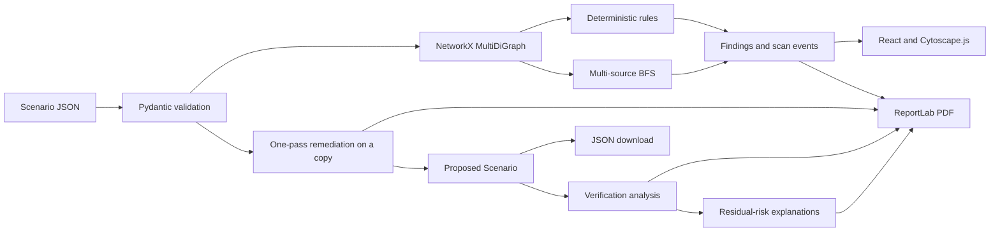

# Architecture

This document describes the implementation of Cloud Security Visualiser. The system analyzes a simplified Scenario supplied by the user or loaded from a bundled JSON file. It does not discover or modify real cloud resources.

## System overview



## Backend modules

| Module | Responsibility |
| --- | --- |
| `models.py` | Defines Pydantic `Node`, `Edge`, `Scenario`, `Finding`, and `ScanRequest` models; enforces resource/edge limits, port range, unique IDs, and valid edge references. |
| `scenarios.py` | Maps the `secure` and `vulnerable` IDs to bundled JSON files and validates them as `Scenario` instances. |
| `graph_builder.py` | Converts a validated Scenario into a directed NetworkX `MultiDiGraph` while preserving node metadata and every edge. |
| `security_rules.py` | Evaluates direct public SSH and database exposure rules against graph edges. |
| `attack_paths.py` | Runs multi-source BFS from Internet nodes and returns the first qualifying path to a private sensitive resource through compute. |
| `remediation.py` | Creates a new Scenario without supported direct public SSH/database edges and records each proposed removal. |
| `risk_explanations.py` | Maps verification findings and paths to resource names, concrete connection evidence, reasons, manual mitigation, and operational-impact text. |
| `pdf_report.py` | Builds a paginated PDF assessment in an in-memory `BytesIO` buffer using ReportLab. |
| `main.py` | Defines FastAPI routes and orchestrates validation, analysis, remediation, verification, explanations, and reporting. |

## Frontend responsibilities

### `frontend/src/App.tsx`

`App` owns the workflow and request state:

- Loads predefined graph previews from `/api/scenarios/{scenario_id}`.
- Parses an uploaded `.json` file locally, then sends it to `/api/validate`.
- Chooses `/api/scan` for predefined scenarios and `/api/scan-custom` for uploads.
- Replays backend scan events with timed UI updates.
- Displays finding details and starts attack-path playback.
- Requests `/api/remediate` only for a validated, scanned custom Scenario.
- Creates the proposed JSON download from the remediation response.
- Requests `/api/report`, verifies the PDF content type, and downloads the response.
- Aborts superseded requests and ignores stale responses when the selected input changes.

The frontend receives the complete analysis response before animating it; it does not use WebSockets or stream scan events.

### `frontend/src/GraphCanvas.tsx`

`GraphCanvas` converts graph data into Cytoscape elements. Nodes use Scenario IDs, and edges receive distinct `edge-{index}` IDs so parallel connections remain separate. A directed breadth-first layout starts from all Internet nodes.

React effects translate scan and attack-path state into Cytoscape classes for visited nodes, explored edges, findings, the current path step, traversed path edges, and the destination. Clicking a node displays its type, public flag, and sensitive flag.

Vite serves the development frontend and proxies `/api` requests to `http://127.0.0.1:8000`.

## Data models and validation

### Node

```text
id: string
name: string
type: internet | compute | database
public: boolean
sensitive: boolean
```

### Edge

```text
source: existing node ID
target: existing node ID
protocol: string
port: integer from 1 through 65535
reason: string
```

### Scenario

```text
id: string
name: string
description: string
nodes: at most 100 Node objects
edges: at most 500 Edge objects
```

Scenario validation rejects duplicate node IDs and edge endpoints that do not reference a node in the same Scenario. FastAPI applies this validation before custom validation, scanning, remediation, or reporting handlers run.

## Graph and parallel connections

`build_graph` creates an `nx.MultiDiGraph`, so direction and multiple edges between the same source and target are preserved. Each edge retains its protocol, port, and reason.

Security rules evaluate every parallel edge independently. BFS traverses resource successors rather than individual parallel edges, so it emits one traversal event per resource hop. When a path remains after remediation, `risk_explanations.py` expands each hop back into all preserved parallel connections to provide complete evidence.

## Analysis pipeline

`analyze_scenario` performs the following deterministic sequence:

1. Add a `scan_started` event.
2. Build the `MultiDiGraph`.
3. Run the public SSH rule and record finding events.
4. Run the direct database rule and record finding events.
5. Run attack-path BFS, which records visited-node, traversed-edge, and path-found events.
6. If a path exists, add one critical finding for its destination.
7. Add a `scan_completed` event and calculate summary counts.

### Rule evaluation

- **SSH:** Internet source, compute target, TCP protocol (case-insensitive), port 22.
- **Database:** Internet source, database target, TCP protocol, port 3306 or 5432. A sensitive database produces a critical finding; another database produces a high finding.

The rules use resource types and directed edge attributes. They do not model identities, operating-system configuration, packet filtering, credentials, vulnerabilities, or service behavior.

### Multi-source BFS

The BFS queue starts with every node whose type is `internet`. Each search state is `(node_id, has_compute)`, allowing the same node to be considered differently depending on whether the path has already passed through compute.

Parent pointers reconstruct the first path that reaches a node with `sensitive=true` and `public=false` after compute has been encountered. Visited-state tracking and an ancestor check prevent repeated states and cycles. Edge direction is respected. A direct Internet-to-sensitive-database edge does not qualify as this attack-path rule because the path has not passed through compute.

The function returns immediately after the first qualifying BFS destination, so the API reports zero or one potential path.

## Remediation and verification orchestration

`remediate_scenario` iterates over the original Scenario edges in order. It excludes only supported Internet-to-compute TCP/22 and Internet-to-database TCP/3306 or TCP/5432 connections, records a structured `remove_connection` proposal for each, and copies every other edge into a new Scenario. The new data is validated again with Pydantic.

`build_remediation_result` in `main.py` is shared by `/api/remediate` and `/api/report`:

1. Analyze the original Scenario.
2. Generate one remediation proposal.
3. Analyze the proposed Scenario once.
4. Explain residual findings and paths from verification evidence.
5. Return before/after counts and a supported-risk status.

There is no iterative remediation loop. The original Pydantic model is not mutated, and nothing is sent to a cloud provider.

## Residual-risk explanations

For a remaining path, the explanation layer lists each resource hop and all matching preserved connections. It states why modeled reachability remains, why the one-pass engine stopped, what a reviewer could do manually, and what traffic could be disrupted.

For other remaining findings, it locates the direct connection evidence that matches the SSH or database rule. Explanations are derived from the proposed Scenario and verification result rather than generated from an external service.

## PDF generation

`POST /api/report` runs the shared remediation lifecycle and passes the result to `generate_security_report`. ReportLab builds the document entirely in memory and returns bytes with `Content-Type: application/pdf` and an attachment filename.

The report contains:

- Infrastructure and resource details.
- Initial findings.
- Proposed changes and operational impacts.
- Before/after verification counts.
- Residual findings and connection evidence.
- Remaining potential paths and their hops.
- Scope and security limitations.

No generated report is stored by the application.

## Request lifecycles

### Predefined scenario

```text
GET /api/scenarios/{scenario_id}
    -> load bundled JSON -> validate -> build graph -> return preview

POST /api/scan {scenario_id}
    -> load bundled JSON -> validate -> analyze -> return findings/path/events
```

### Custom scenario

```text
Browser reads JSON file
    -> POST /api/validate -> Pydantic validation -> graph preview
    -> POST /api/scan-custom -> analysis + supported-risk status
```

### Remediation and outputs

```text
POST /api/remediate with Scenario
    -> original analysis -> one-pass proposal -> verification
    -> residual explanations -> combined JSON response
    -> browser downloads proposed_configuration as JSON

POST /api/report with Scenario
    -> same orchestration -> ReportLab -> PDF attachment
```

## Test coverage

The `tests/` suite covers model validation, bundled scenarios, graph metadata, parallel edges, rule conditions, BFS direction/cycles/multiple Internet roots, scan event order, custom and predefined APIs, one-pass remediation, original-data preservation, residual evidence, report content, and PDF response behavior.
